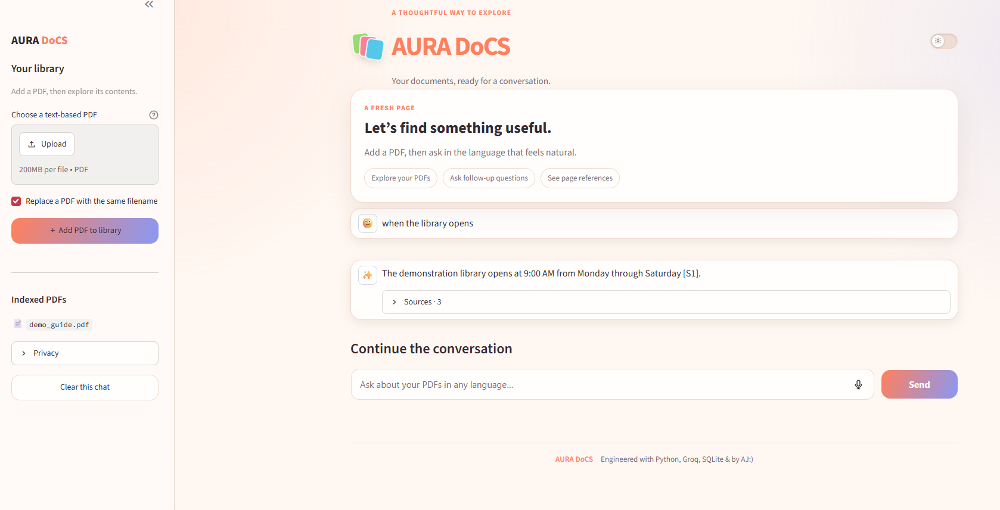
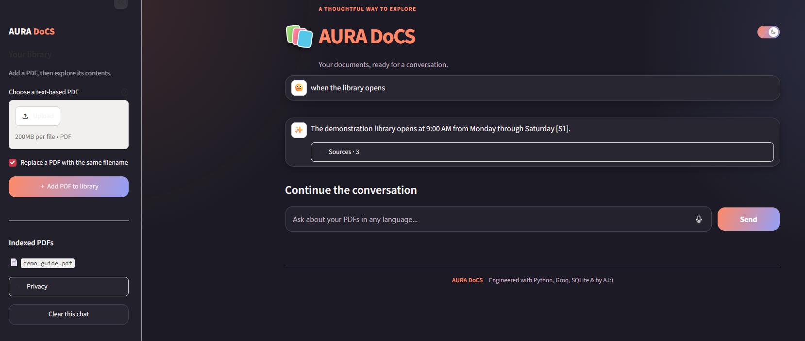
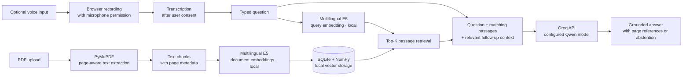

<div align="center">

# 📚 AURA DoCS


### Your documents, ready for a conversation.

Ask questions about text-based PDFs, get document-grounded answers, and follow page references—all in a warm, multilingual chat interface.

</div>

---

## 🎨 AURA in two moods

<table>
  <tr>
    <td align="center" width="50%">
      <strong>🌅 Peach Sunrise · Light theme</strong><br><br>
      
    </td>
    <td align="center" width="50%">
      <strong>🌙 Midnight Bloom · Dark theme</strong><br><br>
      
    </td>
  </tr>
</table>

## 🪸 AURA color palette

| UI accent | Color |
|---|---|
| Coral | `#FF805D` |
| Soft blue | `#8998F3` |
| Warm background | `#FFF7F1` |
| Deep text | `#342A32` |

## ✨ What is AURA DoCS?

AURA DoCS is a PDF question-answering app built with **retrieval-augmented generation (RAG)**. In simple terms, it searches a PDF for relevant passages first, then uses those passages to help answer your question.

Answers include source and page references where available. When the retrieved text does not provide enough evidence, the app can abstain rather than present an unsupported answer.

## 🧭 How it works



### Answer flow

1. **Upload:** Add a text-based PDF from the library panel.
2. **Extract:** PyMuPDF extracts text locally while retaining page information.
3. **Embed and store:** A multilingual E5 embedding model represents document passages locally; SQLite stores the vectors and metadata.
4. **Retrieve:** A question is embedded locally and matched against stored passages using NumPy.
5. **Answer:** The question and selected passages are sent to the configured answer service to produce a response with source references when available.
6. **Optional voice:** Record a question and approve transcription before audio is sent to the configured transcription service.

> **Storage choice:** Document vectors are stored in SQLite and searched with NumPy. This project does not use Chroma.

## 🌟 Features

- **PDF chat:** Ask questions about indexed, text-based PDFs.
- **Page-aware references:** Follow source references back to document pages.
- **Multilingual retrieval:** Uses `intfloat/multilingual-e5-small` for local query and passage embeddings.
- **Evidence-aware answers:** Answers use retrieved passages; the app can abstain when the retrieved evidence is insufficient.
- **Follow-up questions:** Conversation context is bounded and available for follow-ups.
- **Optional voice workflow:** A microphone control, browser recording, and transcription flow with explicit consent.
- **Light and dark themes:** Peach Sunrise and Midnight Bloom match AURA’s coral-and-blue styling.
- **Local document indexing:** PDF extraction, embeddings, and the SQLite vector store run locally.
- **No separate vector database service:** Retrieval uses SQLite and NumPy.

## 🧰 Tech stack

| Area | Technology | Purpose |
|---|---|---|
| App and UI | Python, Streamlit | Application logic and interactive interface |
| Composer and theme control | HTML, CSS, JavaScript, Streamlit Components | Inline chat controls and theme switch |
| PDF extraction | PyMuPDF | Extract PDF text and page information |
| Embeddings | Sentence Transformers, `intfloat/multilingual-e5-small` | Create multilingual embeddings locally |
| Vector storage | SQLite | Store document passages, metadata, and embeddings |
| Similarity search | NumPy | Compare query and document vectors |
| Answer generation | Groq API, configured Qwen model | Generate responses from retrieved passages |
| Optional transcription | Browser audio input and configured transcription model | Turn an approved recording into a question |

## 🚀 Run locally

1. Clone the repository and enter its folder:

   ```powershell
   git clone https://github.com/YOUR-GITHUB-USERNAME/aura-docs.git
   cd aura-docs
   ```

2. Create and activate a virtual environment:

   ```powershell
   python -m venv .venv
   .\.venv\Scripts\Activate.ps1
   ```

3. Install the project dependencies:

   ```powershell
   python -m pip install --upgrade pip
   python -m pip install -r requirements.txt
   ```

4. Create your local environment file:

   ```powershell
   Copy-Item .env.example .env
   ```

   Edit `.env` locally. Add your own API key and a model ID currently available to your account. **Never commit `.env` or share its contents.**

5. Start the app:

   ```powershell
   python -m streamlit run app.py
   ```

The multilingual embedding model may need to download the first time the app is run.

## 🔐 Privacy notes

- PDF extraction, embedding, and vector storage are performed locally.
- When you ask a question, the configured answer service receives the question, matching PDF passages, and relevant follow-up context.
- Voice audio is sent separately for transcription only after you choose the transcription action and give consent.
- Use PDFs with external services only if you have permission to share the relevant content. API model access and limits depend on your provider account.

## ⚠️ Scope and limitations

- Scanned or image-only PDFs need OCR; OCR is not included.
- Multilingual retrieval can help with cross-language questions, but results depend on the document and wording.
- Page references help locate evidence; always check the original passage for important decisions.
- The sample `demo_guide.pdf`, if included, is fictional demonstration content—not real library policy.
- Retrieval evaluation and generated-answer quality are different things. See [`docs/evaluation.md`](docs/evaluation.md) for evaluation notes.

## 📁 Project layout

```text
aura-docs/
├── app.py
├── app_factory.py                 # Pipeline setup is under rag/
├── rag/                           # PDF QA, retrieval, embeddings, and storage
├── ui_components/
│   └── aura_controls/
│       └── index.html             # Inline composer and theme control
├── scripts/                       # Utility and evaluation scripts
├── docs/
│   ├── assets/                    # README dashboard screenshots
│   └── evaluation.md
├── data/
│   └── demo/                      # Optional synthetic demo material
├── requirements.txt
├── .env.example
├── .gitignore
└── README.md
```

<div align="center">

**AURA DoCS** · Python · Streamlit · SQLite · NumPy  
*Engineered with care by AJ :)*

</div>