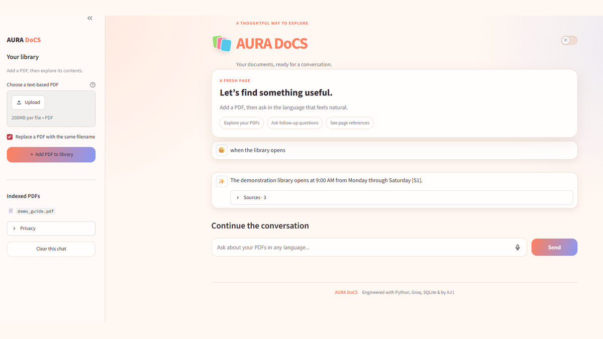
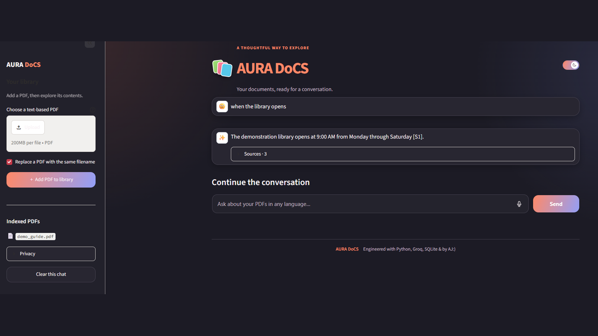
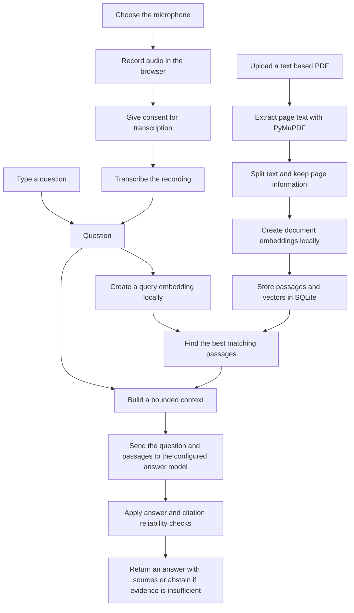

<div align="center">
  <h1>📚 AURA DoCS</h1>

  <p>
    
    
    
    
    
    
  </p>

  <p><strong>Your documents, ready for a conversation.</strong></p>

  <p>
    Ask questions about text-based PDFs, explore answers with page references,
    and chat in the language that feels natural.
  </p>
</div>

---

## 🌅 Dashboard gallery

<table>
  <tr>
    <td align="center" width="50%">
      <strong>🌅 Peach Sunrise · Light theme</strong><br><br>
      
    </td>
    <td align="center" width="50%">
      <strong>🌙 Midnight Bloom · Dark theme</strong><br><br>
      
    </td>
  </tr>
</table>


## ✨ What is AURA DoCS?

AURA DoCS is a PDF question-answering app built around retrieval-augmented generation (RAG). In simple terms, it first searches your PDFs for relevant passages, then uses those passages to help answer your question.

The app includes source and page references where available. If there isn’t enough evidence in the retrieved passages, it can abstain rather than invent an answer.

## 🧭 How the workflow works



> The chart uses GitHub’s Mermaid rendering and describes AURA DoCS’s current workflow. It is a documentation diagram, not a LangGraph runtime graph.

### The process

1. **Add a PDF:** Upload a text-based PDF to your library.
2. **Extract text:** PyMuPDF extracts text with page information.
3. **Prepare the index:** The app splits text into passages and creates multilingual embeddings locally.
4. **Store passages:** SQLite stores passages, metadata, and vectors. NumPy is used for vector comparison.
5. **Ask a question:** The app searches the local index for relevant passages.
6. **Generate a response:** The question and selected passages are sent to the configured answer service.
7. **Return sources or abstain:** The answer includes available source references; the app can abstain if its evidence is insufficient.

For voice questions, the browser records audio. The recording is sent for transcription only after the user selects the transcription action and gives consent.

## 🌟 Features

- **Chat with text-based PDFs** using document-grounded retrieval.
- **Multilingual embeddings** for questions and passages.
- **Cross-language retrieval support**; results depend on the PDF, language, and question wording.
- **Source and page references** to help locate retrieved passages.
- **Follow-up questions** with bounded conversation history.
- **Evidence-aware abstention** when the available passages are insufficient.
- **Optional voice questions** with a separate recording, consent, and transcription flow.
- **Peach Sunrise and Midnight Bloom themes.**
- **Local PDF indexing and vector storage** using SQLite and NumPy.
- **No Chroma or separate vector database service.**

## 🧰 Tech stack

| Area | Technology | Role |
|---|---|---|
| Application | Python | App and RAG pipeline |
| Web interface | Streamlit | PDF library, chat, and source display |
| Composer and theme controls | HTML, CSS, JavaScript, Streamlit Components | Inline input, microphone, and theme switch |
| PDF extraction | PyMuPDF | Extract text and page information |
| Embeddings | Sentence Transformers, `intfloat/multilingual-e5-small` | Create multilingual embeddings locally |
| Vector storage | SQLite | Store document passages, vectors, and metadata |
| Vector search | NumPy | Compare query and document vectors |
| Answer generation | Groq API and the configured Qwen model | Generate responses from retrieved passages |
| Optional transcription | Browser audio input and the configured transcription model | Transcribe a question after consent |
| Configuration | `python-dotenv` | Load local environment settings |

## 🔐 Privacy

- PDF text extraction, embedding, and vector storage happen locally.
- When you ask a question, the configured answer service receives your question and the selected PDF passages.
- Voice audio is handled separately and is sent for transcription only after you choose to transcribe and give consent.
- Do not commit `.env`, private PDFs, or local vector-store data to GitHub.

Only upload documents to external services if you have permission to share the relevant content. Model availability, provider limits, and account access may vary.

## ⚠️ Scope and limitations

- Scanned or image-only PDFs need OCR; OCR is not included.
- Multilingual retrieval can help with cross-language questions, but it is not guaranteed to work equally well for every PDF and language.
- A source reference helps locate a passage; it does not by itself prove that the passage semantically supports every part of an answer.
- The demonstration library PDF, if included, is fictional demo material.
- Evaluation notes are in [`docs/evaluation.md`](docs/evaluation.md). Synthetic test results should not be treated as proof of performance on real PDFs.

## 🚀 Run locally

1. Clone your repository:

   ```powershell
   git clone https://github.com/YOUR-GITHUB-USERNAME/aura-docs.git
   cd aura-docs
   ```

2. Create and activate a virtual environment:

   ```powershell
   python -m venv .venv
   .\.venv\Scripts\Activate.ps1
   ```

3. Install dependencies:

   ```powershell
   python -m pip install --upgrade pip
   python -m pip install -r requirements.txt
   ```

4. Create a local environment file:

   ```powershell
   Copy-Item .env.example .env
   ```

   Edit `.env` locally and add your own API key and an available model ID. Never commit `.env` or paste its contents into chat.

5. Start the app:

   ```powershell
   python -m streamlit run app.py
   ```

The local embedding model may need to download the first time it is used.

## 📁 Project structure

```text
aura-docs/
├── app.py
├── rag/
│   ├── app_factory.py
│   ├── chunking.py
│   ├── conversation.py
│   ├── embeddings.py
│   ├── evaluation.py
│   ├── llm.py
│   ├── models.py
│   ├── pdf_processor.py
│   ├── pipeline.py
│   ├── reliability.py
│   ├── retrieval.py
│   └── vector_store.py
├── ui_components/
│   └── aura_controls/
│       └── index.html
├── scripts/
│   ├── evaluate_retrieval.py
│   └── prepare_readme_images.py
├── docs/
│   ├── assets/
│   └── evaluation.md
├── data/
│   └── demo/
├── requirements.txt
├── .env.example
├── .gitignore
└── README.md
```

<div align="center">
  <strong>AURA DoCS</strong> · Python · Streamlit · SQLite · NumPy<br>
  <em>Engineered with care by AJ :)</em>
</div>